# Bài thực hành số 4 – Tạo dữ liệu mẫu cho dự án WebDocTruyen (Nhóm 9)

Công cụ: https://mockaroo.com/ (format SQL). 5 bảng chính được dựng trên Mockaroo, schema đã lưu trong tài khoản:

| Bảng | Số dòng | Schema đã lưu |
|---|---|---|
| NguoiDung | 30 | https://mockaroo.com/schemas/737162 |
| TheLoai | 6 | https://mockaroo.com/schemas/737159 |
| Truyen | 12 | https://mockaroo.com/schemas/737151 |
| ChuongTruyen | 36 (12 truyện × 3 chương) | https://mockaroo.com/schemas/737161 |
| GoiDoc | 3 | https://mockaroo.com/schemas/737160 |

Các bước làm giống nhau cho mọi bảng: (1) vào Mockaroo → (2) đặt tên cột → (3) chọn kiểu dữ liệu → (4) đặt tên bảng, số dòng, format SQL → Preview → (5) Save As.

## 1. NguoiDung (30 bản ghi)

| Cột | Kiểu Mockaroo |
|---|---|
| MaNguoiDung | Row Number |
| TenDangNhap | Username |
| HoTen | Full Name |
| Email | Email Address |
| MaVaiTro | Custom List `3,4,4,4,4` (khóa ngoại → VaiTro) |
| NgayTao | Datetime, format SQL datetime |
| MatKhauHash | Password Hash |
| IsKhoa | Custom List `0,…,0,1` |

| Bước | Hình |
|---|---|
| 1. Truy cập Mockaroo | 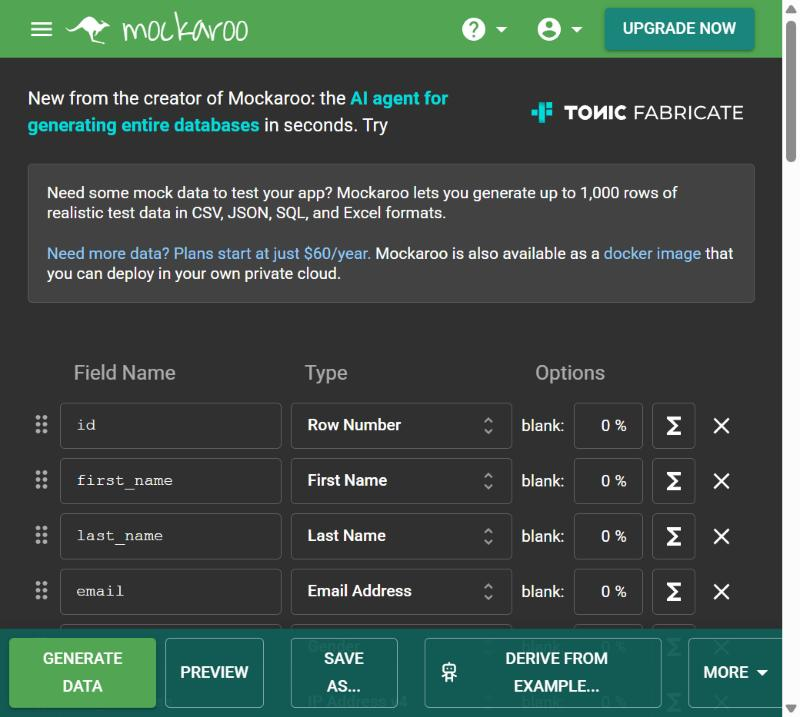 |
| 3. Hộp chọn kiểu dữ liệu | 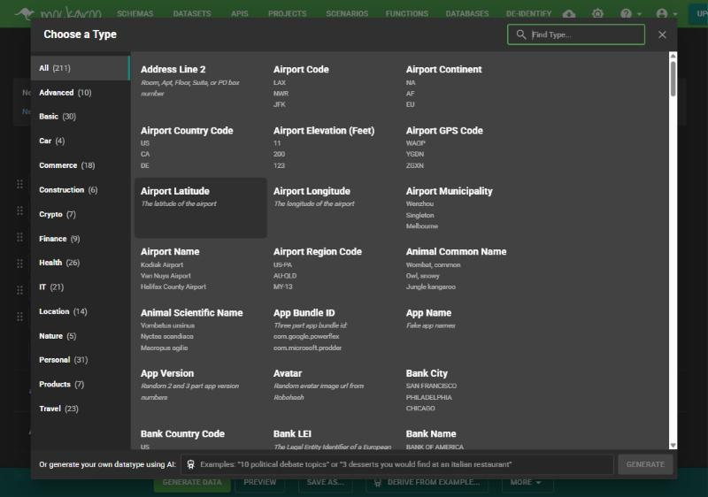 |
| 3. Cột NgayTao kiểu Datetime | 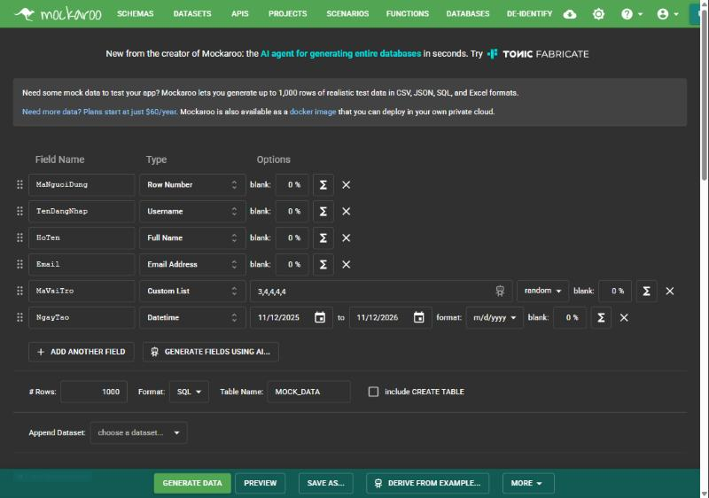 |
| 2–3. Đã định nghĩa đủ cột, tên bảng, 30 dòng | 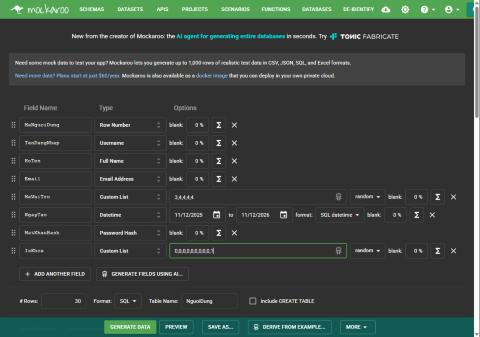 |
| 4. Preview | 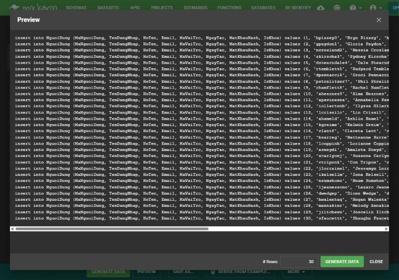 |
| 5. Lưu schema | 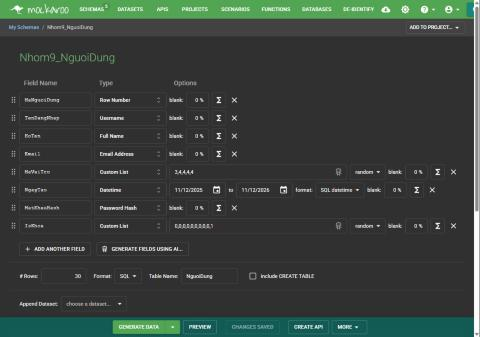 |

## 2. TheLoai (6 bản ghi)

| Cột | Kiểu Mockaroo |
|---|---|
| MaTheLoai | Row Number |
| TenTheLoai | Custom List (Tiên hiệp, Huyền huyễn, Kiếm hiệp, Ngôn tình, Đô thị, Khoa huyễn) |
| Slug | Custom List, thứ tự `sequential` khớp với tên |
| MoTa | Custom List, thứ tự `sequential` |

| Bước | Hình |
|---|---|
| Định nghĩa cột và kiểu dữ liệu | 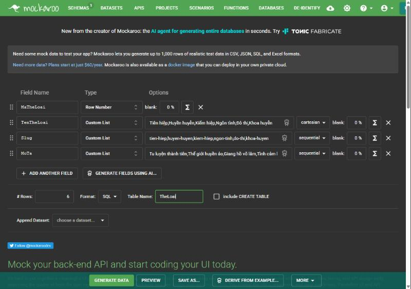 |
| Preview | 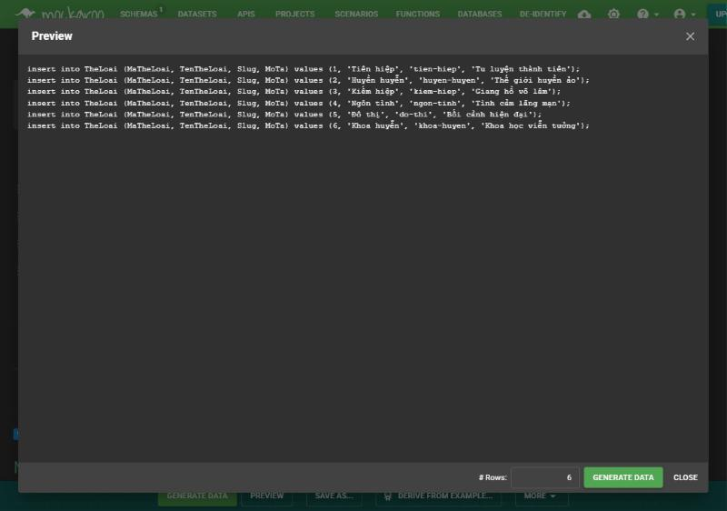 |
| Lưu schema | 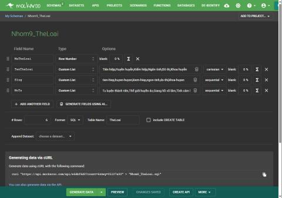 |

## 3. Truyen (12 bản ghi)

| Cột | Kiểu Mockaroo |
|---|---|
| MaTruyen | Row Number |
| TenTruyen | Custom List (tên truyện tiếng Việt) |
| Slug | Formula `'truyen-' + field('MaTruyen').to_s` |
| TacGia | Full Name |
| MoTa | Custom List |
| TrangThai | Custom List `Đang phát hành,…,Hoàn thành` |
| ChinhSachTruyCap | Custom List `Free,Free,Paid` |
| GiaBan | Formula `field('ChinhSachTruyCap') == 'Paid' ? 30000 : 0` |
| LuotXem | Number 100–5000 |

| Bước | Hình |
|---|---|
| Định nghĩa cột và kiểu dữ liệu | 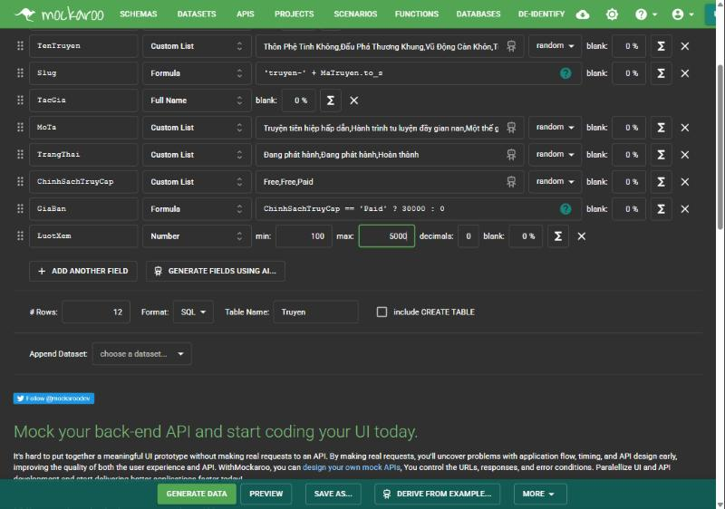 |
| Preview (Slug/GiaBan đã đúng) | 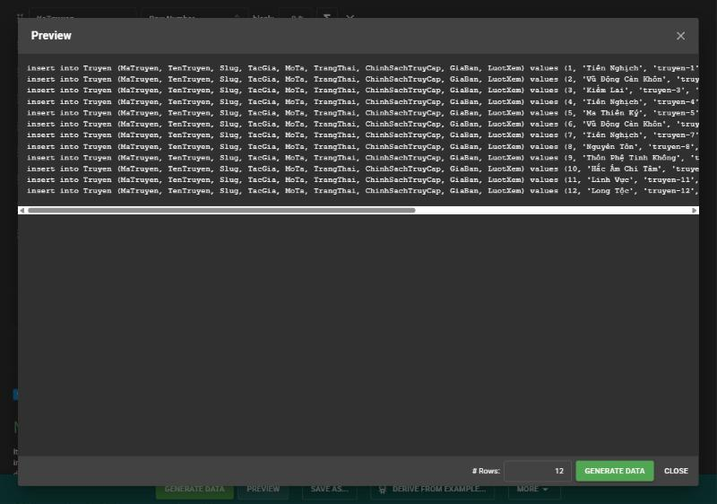 |
| Lưu schema | 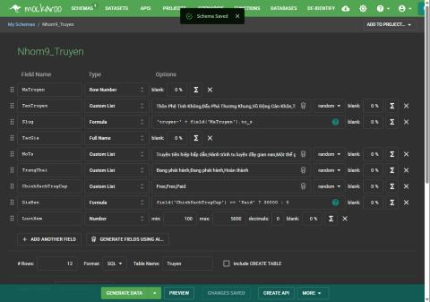 |

Lưu ý: Formula lần đầu báo lỗi vì tên cột viết hoa phải dùng `field('Tên')`; đã sửa.

## 4. ChuongTruyen (36 bản ghi)

| Cột | Kiểu Mockaroo |
|---|---|
| MaChuong | Row Number |
| MaTruyen | Formula `(field('MaChuong')-1)/3+1` (khóa ngoại → Truyen, mỗi truyện 3 chương) |
| SoThuTuChuong | Formula `(field('MaChuong')-1)%3+1` |
| TieuDe | Formula `'Chương ' + field('SoThuTuChuong').to_s` |
| NoiDung | Sentences (1–2 câu) |
| MienPhi | Formula `field('SoThuTuChuong') <= 2 ? 1 : 0` |
| LuotXem | Number 1–100 |

| Bước | Hình |
|---|---|
| Định nghĩa cột và kiểu dữ liệu | 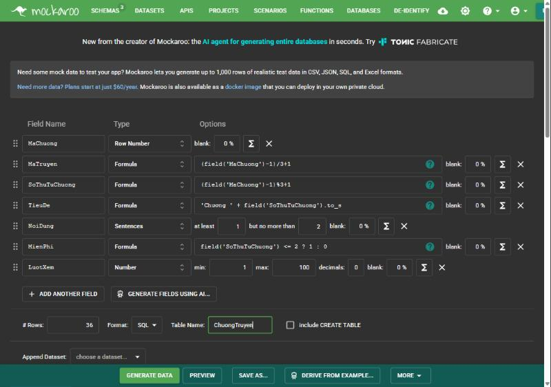 |
| Preview | 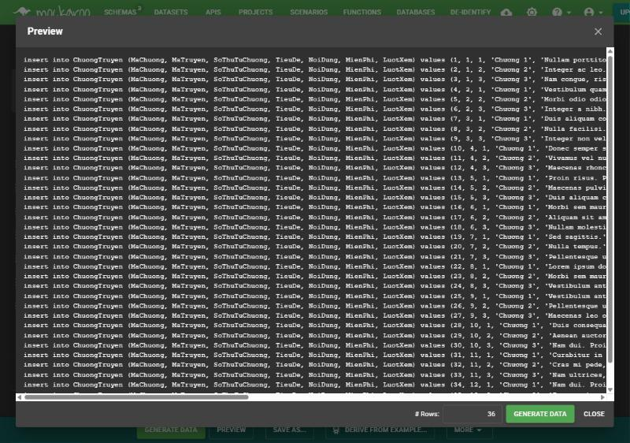 |
| Lưu schema | 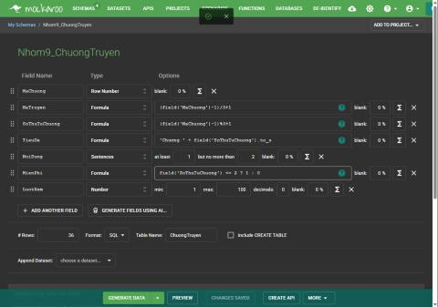 |

## 5. GoiDoc (3 bản ghi)

| Cột | Kiểu Mockaroo |
|---|---|
| MaGoiDoc | Row Number |
| TenGoi | Custom List `Gói 1 tháng,Gói 3 tháng,Gói 1 năm`, `sequential` |
| GiaTien | Formula (tra theo TenGoi: 50.000 / 129.000 / 450.000) |
| SoNgayHieuLuc | Formula (30 / 90 / 365) |
| MoTa | Formula `'Đọc không giới hạn ' + field('SoNgayHieuLuc').to_s + ' ngày'` |
| IsHoatDong | Custom List `1` |

| Bước | Hình |
|---|---|
| Định nghĩa cột và kiểu dữ liệu | 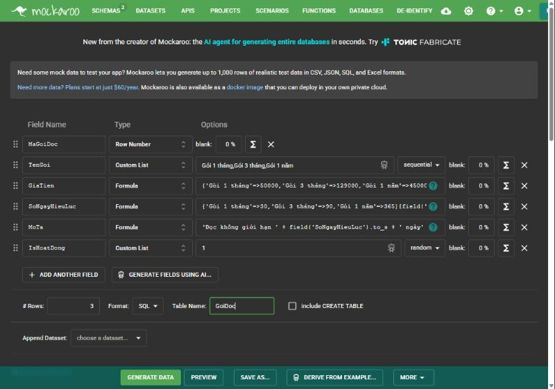 |
| Preview | 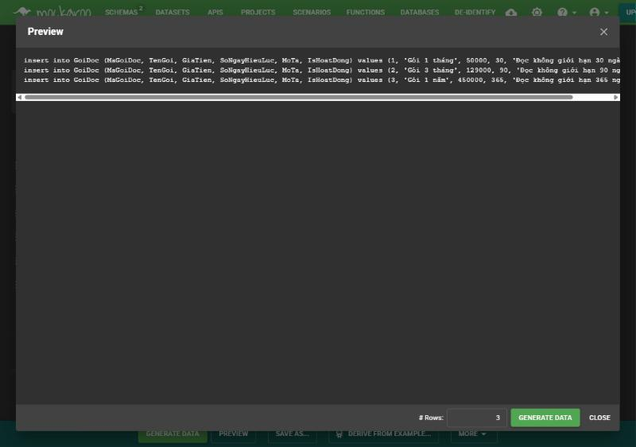 |
| Lưu schema | 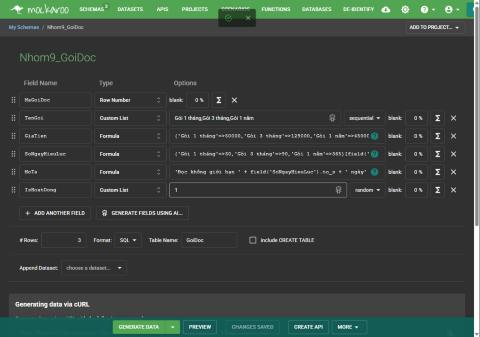 |

## 6. 11 bảng còn lại (làm trên Mockaroo, không chụp ảnh)

Các cột khóa ngoại dùng kiểu **Formula** (Ruby) để giá trị luôn tồn tại ở bảng cha: `field('Tên cột')` lấy giá trị cột cùng dòng, mảng `[..][field('Id')-1]` chọn giá trị theo số thứ tự.

| Bảng | Số dòng | Schema đã lưu | Cách sinh dữ liệu chính |
|---|---|---|---|
| VaiTro | 4 | /schemas/737164 | Formula tra mảng theo MaVaiTro (Admin, Biên tập viên, Tác giả, Thành viên) |
| TruyenTheLoai | 12 | /schemas/737165 | MaTheLoai = `(MaTruyen-1)%6+1` |
| KhuyenMai | 3 | /schemas/737167 | Formula mảng: WELCOME10, TET2026, HE2026 |
| NguoiDungGoiDoc | 8 | /schemas/737168 | Mảng người dùng/gói/ngày, 1 dòng Expired |
| LichSuGiaoDich | 11 | /schemas/737178 | Khóa ngoại/số tiền dùng Formula; PhuongThucThanhToan, TrangThai = Custom List; NgayTao = Datetime |
| TruyenDaMua | 3 | /schemas/737183 | MaNguoiDung Custom List, MaTruyen Formula; NgayMua = Datetime; GiaDaTra = Custom List |
| TruyenYeuThich | 20 | /schemas/737186 | MaTruyen Formula `(MaNguoiDung*5)%12+1`; NgayTao = Datetime |
| TienDoDoc | 20 | /schemas/737187 | MaChuongGanNhat Formula (đúng truyện); SoLanDoc = Number 1–5; NgayCapNhat = Datetime |
| DanhGiaTruyen | 20 | /schemas/737188 | SoSao = Number 3–5; NoiDungDanhGia = Sentences; NgayTao = Datetime |
| BinhLuanChuong | 20 | /schemas/737190 | MaChuong/MaNguoiDung Formula; NoiDung = Sentences; IsAn = Custom List; NgayTao = Datetime |
| TinNhanHoTro | 6 | /schemas/737192 | Hội thoại User/Admin dùng Formula; DaDoc = Custom List `0,1`; NgayTao = Datetime |

(Ghi chú: các đường dẫn trên là `https://mockaroo.com/schemas/<số>`.)

## 7. Dataset (phần chính: suy luận nghiệp vụ)

Phần schema Mockaroo ở trên chỉ là cách sinh/nhập dữ liệu. Dataset mới là phần cần suy nghĩ: dữ liệu phải **hợp lý với nghiệp vụ của web đọc truyện**, không phải chuỗi ngẫu nhiên. Mình viết `build_dataset.py` để sinh dataset theo các quy tắc sau và xuất ra `datasets/*.csv` + `SampleData_WebDocTruyen.sql` (script tự kiểm tra tính nhất quán khi chạy).

| Nhóm | Quy tắc suy luận |
|---|---|
| Người dùng | 1 Admin, 1 Biên tập viên, 5 Tác giả, 33 Thành viên; 2 tài khoản bị khóa; họ tên và tên đăng nhập tiếng Việt; mật khẩu băm đúng chuẩn ASP.NET Identity, đăng nhập được bằng `Nhom9@123` |
| Truyện | 16 truyện, tên/tác giả/mô tả thật, mỗi truyện 1–2 thể loại phù hợp; do Tác giả tạo, ngày tạo sau ngày tạo tài khoản tác giả |
| Chính sách & giá | Truyện Free: mọi chương miễn phí. Truyện Paid: 3 chương đầu miễn phí; giá 25.000 (đang ra) / 30.000–35.000 (hoàn thành, phổ biến) |
| Chương | 6–12 chương mỗi truyện, tiêu đề đúng thể loại, ngày phát hành cách nhau theo tuần; lượt xem giảm dần theo chương |
| Lượt xem / thích | Lượt xem truyện = tổng lượt xem các chương; lượt thích tỉ lệ với số người yêu thích và độ phổ biến |
| Mua truyện & gói | Mua lẻ chỉ với truyện Paid; giá trả = giá bán; mã giảm giá chỉ áp dụng khi còn hạn và 1 lần (WELCOME10); gói hết hạn đặt `Expired` |
| Giao dịch | Mỗi giao dịch thành công sinh đúng 1 bản ghi `TruyenDaMua` hoặc `NguoiDungGoiDoc`; có giao dịch `Đã hủy`, `Chờ thanh toán` |
| Hành vi đọc | Chỉ yêu thích/đọc truyện thuộc thể loại người đó quan tâm; chỉ đọc được truyện Free, đã mua hoặc đang có gói; chưa mua thì chỉ đọc tới chương 3; tiến độ ≤ số chương |
| Đánh giá | Chỉ người đã đọc ít nhất 3 chương; số sao suy ra từ độ phổ biến truyện và nội dung nhận xét khớp số sao |
| Bình luận | Chỉ ở chương nằm trong tiến độ đọc; tác giả có trả lời (`MaBinhLuanCha`); 1 bình luận spam bị ẩn (`IsAn = 1`) |
| Hỗ trợ | Gắn với sự kiện thật: giao dịch chờ thanh toán / đã hủy, kèm phản hồi của Admin |

Dataset đã tải lên tab DATASETS của Mockaroo để dùng với kiểu **Dataset Column**:

| Dataset | Nội dung |
|---|---|
| Nhom9_DS_NguoiDung | 40 người dùng (mã, vai trò, họ tên, email, trạng thái khóa, ngày tạo) |
| Nhom9_DS_Truyen | 16 truyện (tên, tác giả, trạng thái, chính sách, giá, lượt xem/thích, người tạo) |
| Nhom9_DS_ChuongTruyen | 149 chương (MaChuong, MaTruyen, SoThuTuChuong) |
| Nhom9_ChuongTruyen, DS_NguoiDung, DS_Truyen | dataset làm lúc đầu cho 3 schema dùng Dataset Column (có thể xóa nếu không cần) |
| Nhom9_NguoiDung, Nhom9_Truyen | dataset 1 cột lỗi (bị đọc nhầm dòng tiêu đề), không dùng nữa, nên xóa |

File CSV đầy đủ của toàn bộ dataset nằm ở `datasets/`; bản SQL tương ứng là `SampleData_WebDocTruyen.sql`. Bản SQL cũ từ các schema Mockaroo giữ ở `SampleData_Mockaroo_schema_version.sql`.

## 8. File kết quả
`SampleData_WebDocTruyen.sql` – dữ liệu 16 bảng từ dataset có suy luận; chạy theo thứ tự trong file, chỉ trên DB test/local.
