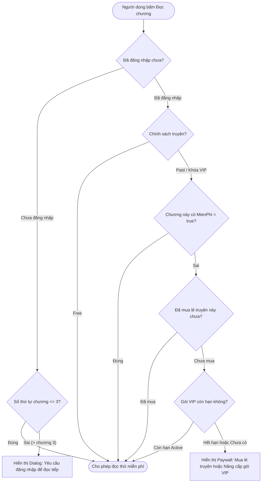
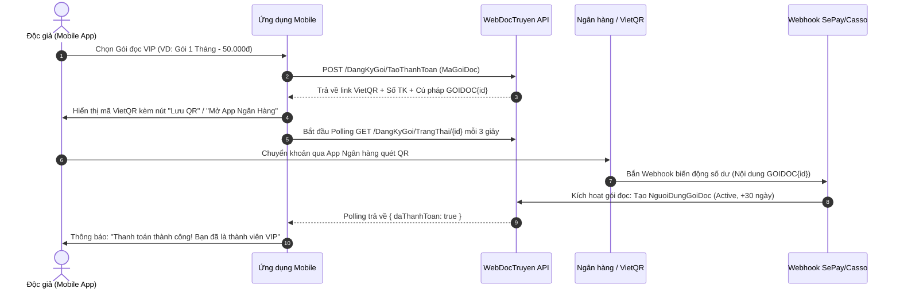

# TÀI LIỆU PHÂN TÍCH SOURCE CODE & ĐẶC TẢ THIẾT KẾ MOBILE APP
## DỰ ÁN: HỆ THỐNG ĐỌC TRUYỆN ONLINE (WebDocTruyen)

> **Mục đích tài liệu:** Tài liệu này tổng hợp toàn bộ cấu trúc source code hiện tại của dự án WebDocTruyen (ASP.NET Core MVC 8.0, SQL Server), bóc tách đầy đủ các phân hệ chức năng, cấu trúc cơ sở dữ liệu, các view giao diện người dùng, danh mục API hiện có và danh mục API cần bổ sung để đội ngũ phát triển có thể thiết kế và xây dựng **Ứng dụng di động (Mobile App - Flutter / React Native / Android Native)** đồng bộ hoàn toàn với hệ thống web.

---

## MỤC LỤC
1. [Tổng Quan Kiến Trúc & Công Nghệ Hiện Tại](#1-tổng-quan-kiến-trúc--công-nghệ-hiện-tại)
2. [Cơ Sở Dữ Liệu & Mô Hình Dữ Liệu (Data Models)](#2-cơ-sở-dữ-liệu--mô-hình-dữ-liệu-data-models)
3. [Phân Tích Chi Tiết Các Chức Năng (Feature Specifications)](#3-phân-tích-chi-tiết-các-chức-năng-feature-specifications)
4. [Bản Đồ Giao Diện Web & Thiết Kế Màn Hình Mobile App (UI Mapping)](#4-bản-đồ-giao-diện-web--thiết-kế-màn-hình-mobile-app-ui-mapping)
5. [Hệ Thống API (Hiện Có & Cần Bổ Sung Cho Mobile App)](#5-hệ-thống-api-hiện-có--cần-bổ-sung-cho-mobile-app)
6. [Luồng Nghiệp Vụ Cốt Lõi (Core Business Flows)](#6-luồng-nghiệp-vụ-cốt-lõi-core-business-flows)
7. [Đề Xuất Kiến Trúc & Công Nghệ Cho Mobile App](#7-đề-xuất-kiến-trúc--công-nghệ-cho-mobile-app)

---

## 1. TỔNG QUAN KIẾN TRÚC & CÔNG NGHỆ HIỆN TẠI

* **Backend:** ASP.NET Core 8.0 MVC / Web API.
* **ORM:** Entity Framework Core 8.0 (Database First & Code Modeling).
* **Database:** Microsoft SQL Server.
* **Xác thực (Authentication):** Hiện đang dùng `Session-based` (`HttpContext.Session.SetString("TaiKhoan")`, `HttpContext.Session.SetInt32("UserId")`, `HttpContext.Session.SetString("VaiTro")`).
* **Frontend Web:** Razor Pages (`.cshtml`), Bootstrap 5, FontAwesome, jQuery/AJAX.
* **Cấu trúc Source Code:**
  * `WebDocTruyen/Controllers/`: Chứa các MVC Controller phục vụ giao diện web (`HomeController`, `TruyenController`, `AccountController`, `DangKyGoiController`) và các API Controller (`TruyenAPIController`, `GiaoDichApiController`, `GoiDocApiController`).
  * `WebDocTruyen/Areas/Admin/`: Phân hệ quản trị độc lập (`DashboardController`, `TruyenManagementController`, `ChuongManagementController`, `TheLoaiManagementController`, `GoiDocController`, `UserManagementController`).
  * `WebDocTruyen/Models/`: Chứa `AppDbContext` và 15 Entity models.
  * `WebDocTruyen/ViewModels/`: Chứa các DTO/ViewModel truyền nhận dữ liệu (`TruyenDetailViewModel`, `LichSuGiaoDichViewModel`, `BinhLuanChuongVM`, `YeuThichViewModel`...).
  * `WebDocTruyen/wwwroot/`: Tài nguyên tĩnh (`Images/` chứa ảnh truyện, banner, file css, js).

---

## 2. CƠ SỞ DỮ LIỆU & MÔ HÌNH DỮ LIỆU (DATA MODELS)

Hệ thống gồm **15 bảng** quản lý toàn bộ vòng đời của người dùng, truyện, chương, tương tác và thanh toán:

### 2.1. Nhóm Nội dung Truyện & Chương
1. **`Truyen`**:
   * `MaTruyen` (int, PK, Identity): Mã truyện.
   * `TenTruyen` (nvarchar(255)): Tên bộ truyện.
   * `Slug` (varchar(255)): Định danh thân thiện URL.
   * `AnhBia` (nvarchar(500)): Đường dẫn ảnh bìa (local hoặc URL).
   * `TacGia` (nvarchar(150)): Tên tác giả.
   * `MoTa` (nvarchar(max)): Tóm tắt nội dung truyện.
   * `TrangThai` (nvarchar(50)): `Đang tiến hành`, `Hoàn thành`.
   * `ChinhSachTruyCap` (nvarchar(20)): `Free` (miễn phí), `Paid` (truyện trả phí/VIP).
   * `GiaBan` (decimal(18,2)): Giá bán lẻ trọn bộ (nếu là `Paid`, mặc định ~49.000đ).
   * `LuotXem` (int): Tổng lượt xem truyện.
   * `LuotThich` (int): Tổng lượt bookmark/yêu thích.
   * `NgayTao`, `NgayCapNhat` (datetime).
2. **`ChuongTruyen`**:
   * `MaChuong` (int, PK, Identity): Mã chương.
   * `MaTruyen` (int, FK -> `Truyen`): Thuộc bộ truyện nào.
   * `SoThuTuChuong` (int): Số thứ tự chương (Chương 1, 2, 3...).
   * `TieuDe` (nvarchar(255)): Tiêu đề chương.
   * `NoiDung` (nvarchar(max)): Nội dung chữ của chương truyện.
   * `MienPhi` (bit): `true` = Miễn phí, `false` = Khóa VIP / Trả phí.
   * `LuotXem` (int): Lượt xem riêng của chương.
   * `NgayPhatHanh` (datetime).
3. **`TheLoai`**:
   * `MaTheLoai` (int, PK, Identity): Mã thể loại.
   * `TenTheLoai` (nvarchar(100)): Tiên Hiệp, Kiếm Hiệp, Huyền Huyễn, Đô Thị, Ngôn Tình, Trinh Thám...
   * `Slug` (varchar(100)), `MoTa` (nvarchar(255)).
4. **`TruyenTheLoai`**: Bảng trung gian quan hệ N-N (`MaTruyen`, `MaTheLoai`).

### 2.2. Nhóm Người Dùng & Phân Quyền
5. **`NguoiDung`**:
   * `MaNguoiDung` (int, PK, Identity): Mã người dùng.
   * `TenDangNhap` (varchar(50)): Duy nhất.
   * `Email` (varchar(100)): Duy nhất.
   * `MatKhauHash` (varchar(255)): Mật khẩu tài khoản.
   * `HoTen` (nvarchar(100)), `SoDienThoai` (varchar(20)), `AnhDaiDien` (varchar(255)).
   * `MaVaiTro` (int, FK -> `VaiTro`): 1: Admin, 2: Biên tập viên, 3: Tác giả, 4: Độc giả.
   * `IsKhoa` (bit): `true` = tài khoản bị vô hiệu hóa/khóa.
   * `NgayTao` (datetime).
6. **`VaiTro`**: `MaVaiTro`, `TenVaiTro` (`Admin`, `Biên tập viên`, `Tác giả`, `Độc giả`).

### 2.3. Nhóm Tương Tác & Cá Nhân Hóa (Interaction)
7. **`TienDoDoc`**:
   * `MaTienDo` (int, PK), `MaNguoiDung`, `MaTruyen`, `MaChuongGanNhat`, `SoLanDoc`, `NgayCapNhat`.
   * Hỗ trợ tính năng: "Đọc tiếp" ngay tại chương đang đọc dở trên mọi thiết bị.
8. **`TruyenYeuThich`**:
   * `MaYeuThich` (int, PK), `MaNguoiDung`, `MaTruyen`, `NgayTao`.
   * Lưu danh sách truyện theo dõi/tủ sách của độc giả.
9. **`DanhGiaTruyen`**:
   * `MaDanhGia` (int, PK), `MaNguoiDung`, `MaTruyen`, `SoSao` (1 đến 5), `NoiDungDanhGia` (nvarchar(2000)), `NgayTao`.
   * Tính điểm trung bình số sao và hiển thị nhận xét.
10. **`BinhLuanChuong`**:
    * `MaBinhLuan` (int, PK), `MaChuong`, `MaNguoiDung`, `MaBinhLuanCha` (int, nullable - trả lời bình luận cấp 2), `NoiDung`, `IsAn` (bit - admin kiểm duyệt ẩn), `NgayTao`.

### 2.4. Nhóm Kinh Doanh, Gói Đọc & Thanh Toán (Monetization)
11. **`GoiDoc`**:
    * `MaGoiDoc` (int, PK), `TenGoi` (VD: Gói Tháng, Gói Quý, Gói Năm), `SoNgayHieuLuc` (30, 90, 365), `GiaTien` (decimal), `MoTa`, `IsHoatDong` (bit).
12. **`NguoiDungGoiDoc`**:
    * `MaDangKy` (int, PK), `MaNguoiDung`, `MaGoiDoc`, `NgayBatDau`, `NgayKetThuc`, `TrangThai` (`Active`, `Expired`).
    * Nếu `NgayKetThuc > DateTime.Now` và `TrangThai == 'Active'`, độc giả được đọc toàn bộ truyện VIP không giới hạn.
13. **`TruyenDaMua`**:
    * `MaGiaoDich` (int, PK), `MaNguoiDung`, `MaTruyen`, `GiaDaTra`, `NgayMua`.
    * Lưu quyền đọc trọn đời cho bộ truyện lẻ trả phí mà người dùng đã mua đứt.
14. **`LichSuGiaoDich`**:
    * `MaGiaoDich` (int, PK, Identity), `MaNguoiDung`, `LoaiGiaoDich` (`MuaTruyen` hoặc `GoiDoc`), `MaMụcTieu` (ID truyện hoặc ID gói đọc), `SoTien`, `MaGiamGia`, `PhuongThucThanhToan` (`VNPAY`, `PayPal`, `VietQR`), `TrangThai` (`Chờ thanh toán`, `Thành công`, `Đã hủy`), `NgayTao`.
15. **`KhuyenMai`**:
    * `MaKhuyenMai`, `MaCode`, `PhanTramGiam`, `GiaTriGiamToiDa`, `NgayBatDau`, `NgayKetThuc`, `IsKichHoat`.

---

## 3. PHÂN TÍCH CHI TIẾT CÁC CHỨC NĂNG (FEATURE SPECIFICATIONS)

### 3.1. Phân hệ Khách vãng lai (Guest - Chưa đăng nhập)
* **Xem trang chủ:** Xem banner truyện nổi bật, top 5 truyện xem nhiều nhất, danh sách truyện mới nhất.
* **Bộ lọc & Sắp xếp:** Lọc theo Thể loại, Trạng thái (Đang tiến hành / Hoàn thành), Sắp xếp theo Lượt xem (nhiều nhất) hoặc Tên truyện (A-Z).
* **Tìm kiếm truyện:** Tìm kiếm theo tên truyện hoặc tên tác giả, hỗ trợ tìm kiếm nhanh (QuickSearch dropdown).
* **Xem chi tiết bộ truyện:** Thông tin tác giả, danh mục thể loại, điểm sao đánh giá, danh sách chương, các bình luận của độc giả.
* **Quy tắc giới hạn đọc thử (US04 - Guest Limit):** Khách chỉ được đọc miễn phí **3 chương đầu tiên** (chương 1, 2, 3). Từ chương 4 trở đi, hệ thống yêu cầu đăng nhập tài khoản.

### 3.2. Phân hệ Độc giả thành viên (Đã đăng nhập)
* **Đăng ký / Đăng nhập / Đăng xuất:** Hỗ trợ đăng nhập bằng Tên đăng nhập hoặc Email.
* **Đọc truyện theo quyền hạn (Access Policy):**
  * Truyện `Free`: Đọc toàn bộ các chương miễn phí không giới hạn.
  * Truyện `Paid`: Được đọc nếu đã **Mua lẻ trọn bộ** (`TruyenDaMua`) HOẶC có **Gói đọc VIP còn hạn** (`NguoiDungGoiDoc`).
* **Tự động lưu tiến độ đọc (`TienDoDoc`):** Khi mở đọc một chương, hệ thống tự động ghi nhận chương gần nhất, hỗ trợ nút "Đọc tiếp" từ trang chủ/trang chi tiết.
* **Quản lý Tủ sách yêu thích:** Bật/tắt theo dõi (Bookmark) truyện vào danh sách yêu thích cá nhân.
* **Đánh giá truyện:** Gửi đánh giá từ 1 đến 5 sao kèm nhận xét chi tiết (tối đa 2000 ký tự), cho phép cập nhật lại đánh giá của chính mình.
* **Bình luận & Thảo luận:**
  * Chọn chương cụ thể để gửi bình luận.
  * Trả lời bình luận của người khác (hỗ trợ phân cấp cha - con 2 cấp).
* **Thanh toán Mua truyện lẻ (US08):** Mua đứt vĩnh viễn quyền đọc một bộ truyện bằng cổng thanh toán (giá cấu hình riêng theo truyện, mặc định 49.000đ).
* **Đăng ký Gói đọc VIP (US07):**
  * Chọn gói VIP (1 tháng, 3 tháng, 1 năm...).
  * Thanh toán qua **VietQR**: Tự động sinh mã QR ngân hàng chuẩn VietQR kèm số tài khoản, tên chủ thẻ, số tiền chính xác và nội dung chuyển khoản `GOIDOC{id}`.
  * Thanh toán qua **PayPal**: Hỗ trợ giao diện xác nhận PayPal thanh toán quy đổi USD.
  * Cơ chế Webhook: Tự động kích hoạt gói đọc ngay khi nhận được tiền từ hệ thống ngân hàng (SePay / Casso).
* **Xem lịch sử giao dịch cá nhân:** Xem danh sách đơn mua truyện, mua gói đọc, số tiền, ngày thanh toán, trạng thái và ngày hết hạn gói VIP.

### 3.3. Phân hệ Quản trị viên (Admin Area)
* **Bảng điều khiển (Dashboard):**
  * Thống kê tổng số truyện, tổng thành viên, tổng lượt đọc.
  * Thống kê doanh thu: Doanh thu tổng, doanh thu bán lẻ truyện, doanh thu gói đọc VIP.
  * Bảng xếp hạng Top truyện hot nhất theo lượt xem.
  * Danh sách giao dịch phát sinh gần đây nhất.
* **Quản lý Truyện:** Thêm mới truyện (upload ảnh bìa), sửa thông tin, đặt chính sách (Free/Paid), thiết lập giá bán lẻ, chọn nhiều thể loại, xóa truyện.
* **Quản lý Chương truyện:** Thêm chương mới, chỉnh sửa nội dung chương, phân trang danh sách chương, đánh dấu chương Miễn phí hay Khóa trả phí.
* **Quản lý Thể loại:** Thêm, sửa, xóa danh mục thể loại truyện.
* **Quản lý Gói đọc VIP:** Thêm gói mới, sửa giá, số ngày hiệu lực, kích hoạt/ngừng kinh doanh gói.
* **Quản lý Người dùng:** Danh sách người dùng, thay đổi vai trò (Admin / Độc giả / Biên tập viên), khóa/mở khóa tài khoản người dùng vi phạm.
* **Kiểm duyệt Bình luận:** Nút Admin ẩn các bình luận vi phạm tiêu chuẩn cộng đồng.

---

## 4. BẢN ĐỒ GIAO DIỆN WEB & THIẾT KẾ MÀN HÌNH MOBILE APP (UI MAPPING)

Dưới đây là bảng đối chiếu giữa các View trên Web và màn hình tương ứng cần thiết kế trên Mobile App:

| STT | Giao diện Web (`.cshtml`) | Màn hình Mobile App tương ứng | Các thành phần UI chính trên Mobile App |
|:---:|---|---|---|
| **0** | *(Không có trên web)* | **Splash / Onboarding Screen** | Logo ứng dụng, câu slogan, kiểm tra Token đăng nhập tự động, màn hình giới thiệu tính năng cho lần đầu mở app. |
| **1** | `Views/Home/Index.cshtml` | **Trang Chủ (Home Screen)** | • Top Carousel Banner truyện HOT (vuốt ngang). • Filter Chips: Thể loại, Trạng thái (Đang ra / Hoàn thành). • Section "Truyện Đọc Nhiều Nhất" (Badge TOP 1, 2, 3). • Section "Gợi ý cho bạn" (Dựa trên thể loại yêu thích). • Grid 2 cột danh sách truyện mới cập nhật (kèm pull-to-refresh & infinite scroll). |
| **2** | `Views/Home/Timkiem.cshtml` | **Màn hình Tìm Kiếm (Search Screen)** | • Thanh tìm kiếm có Debounce (gợi ý nhanh kết quả sau 300ms). • Lịch sử tìm kiếm gần đây & Từ khóa tìm kiếm phổ biến. • Danh sách kết quả dạng List Card (Ảnh bìa, Tên truyện, Tác giả, Lượt xem, Thể loại tag). |
| **3** | `Views/Truyen/Details.cshtml` | **Chi tiết Truyện (Story Detail Screen)** | • Header: Ảnh bìa mờ (Blured backdrop), Cover Card, Tên truyện, Tác giả, Trạng thái. • Stat Bar: Lượt xem, Lượt thích, Số chương, Điểm sao trung bình. • Action Buttons: Nút "Đọc từ đầu", nút "Đọc tiếp" (nếu có lịch sử), nút "Yêu thích" (Heart icon toggle). • Nút "Mua trọn bộ" (nếu là truyện Paid). • Tabs layout:   - Tab Giới thiệu (Tóm tắt truyện).   - Tab Mục lục (Danh sách chương, icon Khóa nếu chương VIP).   - Tab Đánh giá (Biểu đồ sao, danh sách review, nút gửi đánh giá 1-5 sao).   - Tab Bình luận (Bình luận theo chương, trả lời reply). |
| **4** | `Views/Truyen/Doc.cshtml` | **Màn hình Đọc Truyện (Reader Screen)** | **Trọng tâm trải nghiệm:** • Chế độ đọc cuộn liên tục (Vertical scroll) hoặc lật trang (Page turn). • Thanh công cụ đọc (Reader Settings Bottom Sheet): Đổi màu nền (Sáng, Tối - Dark mode, Giấy vàng - Sepia), tùy chỉnh Cỡ chữ (Font size A- / A+), Font chữ (Serif, Sans-serif), Giãn dòng. • Menu chuyển chương nhanh (Chương trước / Chương sau / Danh sách chương modal). • Tự động lưu vị trí cuộn & gửi API lưu tiến độ đọc. • Paywall Dialog: Khi gặp chương > 3 (nếu chưa đăng nhập) hoặc chương VIP (yêu cầu Mua lẻ / Nâng cấp VIP). |
| **5** | `Views/Truyen/YeuThich.cshtml` | **Màn hình Tủ Sách (Library Screen)** | Gồm 3 tab con: • Tab 1: **Đang đọc** (Truyện đang đọc dở từ `TienDoDoc`, hiển thị thanh % tiến độ). • Tab 2: **Yêu thích** (Danh sách truyện đã bấm bookmark). • Tab 3: **Đã mua** (Các bộ truyện lẻ đã thanh toán vĩnh viễn). |
| **6** | `Views/DangKyGoi/Index.cshtml` `XacNhanQR.cshtml` | **Màn hình Nâng cấp VIP (Subscription Screen)** | • Banner quyền lợi VIP (Đọc full toàn bộ truyện, không quảng cáo, mở khóa chương độc quyền). • Danh sách gói: Thẻ gói 1 tháng, 3 tháng, 1 năm (Badge "Phổ biến nhất", "Tiết kiệm nhất"). • Phương thức thanh toán: VietQR và In-app Purchase / PayPal. • Màn hình Thanh toán VietQR: Hiển thị mã QR ngân hàng, nút "Lưu ảnh QR vào máy", nút "Mở ứng dụng Ngân hàng", bộ đếm ngược 15:00 và tự động chuyển màn hình khi nhận được tiền. |
| **7** | `Views/Account/Login.cshtml` `Register.cshtml` | **Màn hình Đăng Nhập / Đăng Ký** | • Input Tên đăng nhập / Email, Mật khẩu (có icon ẩn/hiện mật khẩu). • Nút Đăng nhập / Đăng ký tài khoản mới. • Gợi ý đăng nhập nhanh qua Google / Apple Sign-In (cho mobile app). |
| **8** | `Views/Account/LichSuGiaoDich.cshtml` | **Màn hình Lịch Sử Giao Dịch** | • Thẻ tóm tắt: Tổng số giao dịch, tổng tiền đã chi, hạn dùng VIP hiện tại. • Danh sách thẻ giao dịch (Mã GD `#GD00012`, tên truyện/gói, số tiền, ngày giờ, trạng thái Thành công/Chờ xử lý). |
| **9** | `_Layout.cshtml` (User Profile) | **Màn hình Cá Nhân (Profile Screen)** | • Avatar, Tên người dùng, Email, Huy hiệu VIP (Active / Chưa có). • Mục quản lý: Lịch sử đọc, Lịch sử giao dịch, Đổi mật khẩu. • Cài đặt app: Chế độ sáng/tối hệ thống, thông báo chương mới. • Nút Đăng xuất. |

---

## 5. HỆ THỐNG API (HIỆN CÓ & CẦN BỔ SUNG CHO MOBILE APP)

Hiện tại hệ thống web đã có một số API Controller trả về định dạng JSON, tuy nhiên để Mobile App hoạt động hoàn chỉnh độc lập, cần bổ sung hệ thống API chuẩn RESTful sử dụng **JWT Token (JSON Web Token)** thay vì phụ thuộc Cookie/Session của trình duyệt.

### 5.1. Các API Hiện Có Trong Source Code

| Phương thức | Endpoint API | Chức năng | Request / Params | Response |
|:---:|---|---|---|---|
| **GET** | `/api/Truyen` | Lấy danh sách truyện | Không | Mảng danh sách truyện (MaTruyen, TenTruyen, Slug, AnhBia, TacGia, LuotXem, TrangThai). |
| **GET** | `/api/Truyen/{id}` | Lấy chi tiết truyện kèm các chương | `id` (int): Mã truyện | Đối tượng truyện đầy đủ thông tin kèm danh sách `ChuongTruyens`. |
| **POST** | `/api/Truyen/{maTruyen}/TienDoDoc` | Lưu tiến độ đọc chương | Body: `{ maChuongGanNhat: int }` *(yêu cầu Session)* | `{ message, progress }` |
| **GET** | `/api/Truyen/QuickSearch` | Tìm kiếm nhanh 5 truyện | `keyword` (string) | Mảng 5 truyện (id, title, slug, author, cover, views). |
| **GET** | `/api/GiaoDich/LichSu` | Lấy lịch sử giao dịch người dùng | `userId`, `loaiGiaoDich`, `trangThai` | `{ success, nguoiDung, thongKe, data: [...] }` |
| **GET** | `/api/GiaoDich/ChiTiet/{id}` | Chi tiết 1 giao dịch | `id` (int): Mã giao dịch | `{ success, data: { maGiaoDich, soTien, tenMucTieu... } }` |
| **POST** | `/api/GiaoDich/MuaTruyen` | Mua truyện lẻ | Body: `{ maNguoiDung, maTruyen, phuongThucThanhToan }` | `{ success, message, maGiaoDich, tenTruyen, soTien }` |
| **GET** | `/api/GoiDoc` | Lấy danh sách gói đọc VIP đang bán | Không | Mảng các gói đọc (MaGoiDoc, TenGoi, SoNgayHieuLuc, GiaTien, MoTa). |
| **POST** | `/DangKyGoi/TaoThanhToan` | Khởi tạo giao dịch mua gói VIP | Form/Body: `id` (Mã gói), `phuongThuc` | `{ success, maGiaoDich, qrImage, qrText, noiDung, soTien... }` |
| **GET** | `/DangKyGoi/TrangThai/{id}` | Polling kiểm tra trạng thái thanh toán | `id`: Mã giao dịch | `{ trangThai, daThanhToan, hetHan }` |
| **POST** | `/DangKyGoi/Webhook` | Webhook xác nhận tự động chuyển khoản | Body: `{ content, transferAmount }` | `{ success: true }` |
| **GET** | `/Home/GetRecommend` | Lấy danh sách gợi ý truyện | *(Dựa vào UserId trong Session)* | Mảng 4 truyện được gợi ý. |

---

### 5.2. Danh Mục API Cần Bổ Sung Cho Mobile App (Khuyến nghị chuẩn RESTful)

Vì Mobile App không sử dụng Cookie Session của Web MVC, Backend cần mở rộng thêm các Endpoint REST API với cơ chế xác thực **`Authorization: Bearer <JWT_TOKEN>`**:

#### A. Phân hệ Xác thực (Authentication API)
1. **`POST /api/v1/auth/login`**: Đăng nhập qua mobile.
   * Body: `{ "tenDangNhapHoacEmail": "...", "matKhau": "..." }`
   * Trả về: `{ "token": "jwt_token...", "refreshToken": "...", "user": { "id": 1, "username": "...", "fullName": "...", "email": "...", "role": "DocGia", "isVip": true, "vipExpiredAt": "2026-12-31" } }`.
2. **`POST /api/v1/auth/register`**: Đăng ký tài khoản từ app.
   * Body: `{ "tenDangNhap": "...", "email": "...", "matKhau": "...", "hoTen": "..." }`.
3. **`GET /api/v1/auth/profile`**: Lấy thông tin cá nhân của token hiện tại.
4. **`PUT /api/v1/auth/profile`**: Cập nhật thông tin cá nhân (họ tên, đổi mật khẩu).

#### B. Phân hệ Khám phá & Đọc truyện (Story & Reading API)
5. **`GET /api/v1/home/feed`**: API tổng hợp nạp nhanh dữ liệu trang chủ trong 1 request:
   * Trả về: `{ "banners": [...], "topViews": [...], "recommendations": [...], "newUpdates": [...], "categories": [...] }`.
6. **`GET /api/v1/truyen?page=1&pageSize=10&theLoaiId=...&status=...&sort=...`**: Danh sách truyện có phân trang.
7. **`GET /api/v1/truyen/{id}`**: Chi tiết truyện, thống kê sao, trạng thái đã yêu thích chưa, đã mua lẻ chưa, gói VIP có áp dụng không.
8. **`GET /api/v1/truyen/{id}/chapters`**: Danh sách toàn bộ chương của truyện (chỉ metadata, không lấy nội dung chữ để tải nhanh).
9. **`GET /api/v1/chapters/{id}`**: Lấy nội dung chi tiết chương để hiển thị lên màn hình đọc:
   * Header: `Bearer Token` (nếu có).
   * Kiểm tra quyền:
     * Nếu khách & chương > 3 -> Trả về lỗi `403 Forbidden` kèm mã `REQUIRE_LOGIN`.
     * Nếu truyện trả phí & người dùng chưa mua / chưa có VIP -> Trả về lỗi `403 Forbidden` kèm mã `REQUIRE_PAYMENT`.
   * Trả về: `{ "maChuong": 1, "tieuDe": "...", "noiDung": "...", "chuongTruocId": null, "chuongSauId": 2 }`.
10. **`POST /api/v1/truyen/{id}/progress`**: Lưu chương đang đọc và vị trí cuộn trên app.
    * Body: `{ "maChuong": 12, "percent": 65 }`.

#### C. Phân hệ Tương tác (Interaction API)
11. **`POST /api/v1/truyen/{id}/toggle-favorite`**: Bấm tim yêu thích / bỏ yêu thích.
12. **`GET /api/v1/user/favorites`**: Danh sách truyện đang theo dõi của người dùng.
13. **`GET /api/v1/user/reading-history`**: Lịch sử các truyện đang đọc dở kèm thông tin chương gần nhất.
14. **`GET /api/v1/truyen/{id}/reviews`**: Danh sách đánh giá của truyện kèm điểm sao trung bình.
15. **`POST /api/v1/truyen/{id}/reviews`**: Gửi hoặc cập nhật đánh giá 1-5 sao + nội dung nhận xét.
16. **`GET /api/v1/chapters/{id}/comments`**: Danh sách bình luận theo chương (dạng cây lồng nhau cha - con).
17. **`POST /api/v1/chapters/{id}/comments`**: Gửi bình luận hoặc reply bình luận (`maBinhLuanCha`).

#### D. Phân hệ Gói VIP & Thanh toán Mobile
18. **`GET /api/v1/subscriptions/plans`**: Lấy danh sách gói đọc VIP.
19. **`POST /api/v1/subscriptions/create-qr`**: Tạo đơn hàng VietQR cho mobile. App nhận về URL ảnh QR VietQR để hiển thị trực tiếp.
20. **`GET /api/v1/subscriptions/check-status/{maGiaoDich}`**: Polling kiểm tra trạng thái kích hoạt sau khi chuyển khoản.
21. **`POST /api/v1/truyen/{id}/buy`**: Mua lẻ trọn bộ truyện từ số dư hoặc cổng thanh toán.

---

## 6. LUỒNG NGHIỆP VỤ CỐT LÕI (CORE BUSINESS FLOWS)

### 6.1. Luồng Kiểm Tra Quyền Đọc Chương (Reading Authorization Flow)

---

### 6.2. Luồng Thanh Toán Gói Đọc VIP Qua VietQR Trên Mobile

---

## 7. ĐỀ XUẤT KIẾN TRÚC & CÔNG NGHỆ CHO MOBILE APP

### 7.1. Công Nghệ Đề Xuất
* **Framework:** **Flutter (Dart)** hoặc **React Native (TypeScript)**.
  * *Lý do chọn Flutter:* Hiệu năng vẽ UI 60/120fps mượt mà, công cụ quản lý font chữ, text rendering của Reader Screen rất tối ưu cho app đọc sách, dễ build cả Android và iOS từ một codebase.
* **Quản lý trạng thái (State Management):**
  * Flutter: **BLoC** (Business Logic Component) hoặc **Riverpod**.
  * React Native: **Redux Toolkit** hoặc **Zustand**.
* **Networking:** `Dio` (Flutter) hoặc `Axios` (React Native) có cấu hình Interceptor tự động gắn `Bearer Token` và tự động refresh token khi hết hạn.
* **Lưu trữ Cục bộ (Local Storage / Offline Cache):**
  * `Hive` hoặc `SQLite / Isar`: Dùng để lưu trữ nội dung chương đã tải về (Offline Reading mode), lưu theme, font size, danh sách lịch sử đọc khi mất mạng.
* **Thông báo đẩy (Push Notification):** Tích hợp **Firebase Cloud Messaging (FCM)** để thông báo khi truyện theo dõi ra chương mới.

---

## 8. DANH MỤC THƯ MỤC & FILE TÀI LIỆU

Tài liệu thiết kế chi tiết này được lưu trữ trực tiếp trong repository của dự án tại:
* **Thư mục chứa tài liệu:** `D:\THCNTT\CNPMNC\Nhom9-WebDocTruyen\docs\`
* **Đường dẫn file tài liệu đầy đủ:** [TaiLieu_ThietKe_MobileApp_WebDocTruyen.md](file:///D:/THCNTT/CNPMNC/Nhom9-WebDocTruyen/docs/TaiLieu_ThietKe_MobileApp_WebDocTruyen.md)
